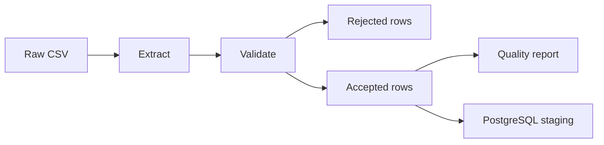

# Session data ETL

Practice pipeline for Behavior Intelligence. The CSV files are synthetic. Do not put real client records here.

Scheduling is not built.

## Pipeline



1. **Extract.** Read the CSV as text. Nothing is cleaned in this step.
2. **Validate.** Drop a row when the date is not a date, the duration is not a positive number, the measurement type is unknown, the raw value is not a number, the client or behavior name is blank, or the same client, date, and behavior already appeared.
3. **Missing versus zero.** A blank, `N/A`, or `null` stays missing. A written `0` stays zero.
4. **Report.** Count rows read, accepted, and rejected, plus the reason for each reject.
5. **Load.** If `DATABASE_URL` is set, upsert accepted rows into `observation_staging`. The unique key is client, session date, and behavior. A second run updates that row. It does not insert a copy.

The staging table is separate from the Prisma tables, so a bad CSV cannot overwrite the chart data.

## Setup

```bash
cd etl
python3 -m venv .venv
source .venv/bin/activate
pip install -r requirements.txt
python -m pytest test_pipeline.py
```

Quality report only, no database:

```bash
python generate_sessions.py
python pipeline.py --csv fixtures/sessions_400.csv
```

Bigger file (stays in `artifacts/`, not git):

```bash
python generate_sessions.py --rows 500000
python pipeline.py --csv artifacts/sessions_500000.csv
```

Load into Postgres. Run it twice and the row count for each key stays one:

```bash
DATABASE_URL="postgresql://USER@localhost:5432/behavior_intelligence" \
  python pipeline.py --csv fixtures/sessions_400.csv
```

If an older `observation_staging` table already has duplicate keys, drop that table once, then run the pipeline again.

## Sample input

From [`fixtures/raw_sessions.csv`](fixtures/raw_sessions.csv):

```csv
client_code,session_date,duration_minutes,behavior_name,measurement_type,raw_value
JM,2026-01-06,60,Requests,frequency,4
JM,2026-01-06,60,Elopement,frequency,0
JM,2026-01-07,45,Requests,frequency,
JM,2026-01-08,50,Requests,frequency,N/A
JM,2026-01-09,0,Requests,frequency,2
JM,not-a-date,60,Requests,frequency,1
JM,2026-01-12,60,Requests,not-a-type,3
JM,2026-01-06,60,Requests,frequency,9
JM,2026-01-13,55,Latency,latency,abc
 ,2026-01-14,40,Requests,frequency,1
```

## Sample output

Accepted rows from that file:

| client_code | session_date | behavior_name | raw_value | value_state |
| --- | --- | --- | --- | --- |
| JM | 2026-01-06 | Requests | 4 | VALUE |
| JM | 2026-01-06 | Elopement | 0 | ZERO |
| JM | 2026-01-07 | Requests |  | MISSING |
| JM | 2026-01-08 | Requests |  | MISSING |

Rejected records from that same file:

| session_date | behavior_name | raw_value | Why it was rejected |
| --- | --- | --- | --- |
| 2026-01-09 | Requests | 2 | Duration is 0 |
| not-a-date | Requests | 1 | Date cannot be parsed |
| 2026-01-12 | Requests | 3 | Measurement type is not one of the six allowed types |
| 2026-01-06 | Requests | 9 | Duplicate of the Requests row already accepted for that client and date |
| 2026-01-13 | Latency | abc | Raw value is not a number |
| 2026-01-14 | Requests | 1 | Client code is blank |

A reload does not insert those keys again. PostgreSQL uses a unique key of client, session date, and behavior. The load is `INSERT ... ON CONFLICT DO UPDATE`, so the second run replaces the existing staging row.

`--rows 500000` writes `artifacts/sessions_500000.csv` (gitignored). Last run on this machine, with Postgres:

```json
{
  "rows_read": 500000,
  "rows_accepted": 400000,
  "rows_rejected": 100000,
  "reject_reasons": {
    "bad_date": 25000,
    "bad_duration": 25000,
    "bad_measurement_type": 25000,
    "duplicate_key": 25000
  },
  "missing_measurements": 25000,
  "true_zeros": 25000,
  "loaded_rows": 400000,
  "seconds": 63.11
}
```

The 400-row file [`fixtures/sessions_400.csv`](fixtures/sessions_400.csv) produces this report when no database is connected (`loaded_rows` is 0):

```json
{
  "rows_read": 400,
  "rows_accepted": 320,
  "rows_rejected": 80,
  "reject_reasons": {
    "bad_date": 20,
    "bad_duration": 20,
    "bad_measurement_type": 20,
    "duplicate_key": 20
  },
  "missing_measurements": 20,
  "true_zeros": 20,
  "loaded_rows": 0
}
```

## Tests last run

```text
test_pipeline.py
4 passed
```

The tests check the 10-row fixture, that a blank is not stored as zero, that the load SQL uses `ON CONFLICT (client_code, session_date, behavior_name) DO UPDATE`, and that applying the same rows twice does not increase the count.
